<p align="center">
  
</p>

An LLM inference server spends most of its life on bookkeeping you never see. It hands out memory in blocks, shares the prompt prefixes that requests have in common, squeezes new requests into a batch that is already running, and lets a small model guess tokens that a big model then accepts or throws away. **Production servers mostly report this as aggregates**: a counter for accepted drafts, a percentage for cache use. (vLLM can also export raw KV-block events, keyed by content hash rather than by request.) You rarely get to watch a single block or a single rejected token.

infviz is a small, honest inference engine that **emits every one of those decisions as an event**, plus a debugger that rebuilds the engine's state from those events and lets you scrub through it step by step, live or from a recorded trace.

> **The short version.** On Qwen2.5-1.5B with a 0.5B draft model, the engine runs paged attention, prefix caching, continuous batching and speculative decoding. In fp32 its output is verified token for token against Hugging Face transformers and against plain greedy decoding. Every number on screen is rebuilt from events, and a test checks that rebuild against the engine's own snapshots. It is a tool for seeing and explaining serving, not a production profiler.

**[The idea](#1--the-idea)** · **[What you see](#2--what-you-see)** · **[A real run](#3--a-real-run)** · **[Limits](#4--where-it-does-not-help)** · **[Run it](#5--run-it)** · **[Repository map](#7--repository-map)**

---

### §1 · The idea

<p align="center">
  
</p>

- **Why a new engine.** llama.cpp's server exposes `/metrics` counters and slot status, with no per-block KV occupancy, no eviction events and no per-token accept or reject. Drawing those would mean inventing them, so infviz runs its own engine on real weights instead.
- **Paged KV cache.** Each model's KV cache is a fixed pool of 16-token blocks. Requests address it through a block table, full blocks are hashed so later requests can reuse a shared prefix, finished blocks stay cached until the least recently used one is evicted, and under memory pressure the newest request is preempted and recomputed.
- **Continuous batching.** Every engine step admits waiting requests, prefills new ones and decodes running ones in a single ragged forward pass, so requests join and leave mid-flight.
- **Speculative decoding.** The draft model proposes k = 4 tokens per lane, and the target verifies all of them in one pass. The engine keeps the accepted prefix plus one token of the target's own, and rolls back the rest of the KV cache in both pools.
- **One event stream.** Every state change is an event ([`docs/EVENTS.md`](docs/EVENTS.md)), sent over a WebSocket or written to a `.jsonl` trace. The web app's reducer is a pure function of those events. Every animation is a function of the playhead position, so scrubbing backwards plays it backwards.

**Related tools.** Several projects show parts of this picture. [vllm-internals-viz](https://github.com/richajoy/vllm-internals-viz) replays vLLM's own scheduler and block pool in the browser, checked against real vLLM traces, with a scripted model instead of attention. [vllm-internals](https://github.com/marcotrinelli/vllm-internals) and [kvstat](https://github.com/samuelkim7/kvstat) record a real vLLM server, rebuilding block placement from its API and metrics or reading its KV-event stream. [SpeculatoViz](https://github.com/samy19980109/Visualize-Speculative-Decoding) and LM Studio colour tokens by draft acceptance, without the cache or the batch, and teaching simulators such as [paged-attention-visualizer](https://github.com/amanichopra/paged-attention-visualizer) animate paged attention with no model. infviz's angle is the combination: real weights, with per-request KV ownership, batching, and per-token acceptance with KV rollback in one event stream that a test checks against the engine's own snapshots.

---

### §2 · What you see

<p align="center">
  
</p>

| Panel | What it shows | How to read it |
|---|---|---|
| **KV cache** | Both block pools at the playhead | colour = owned by that request · stacked grey = prompt prefix shared by several requests · dark grey = cached for reuse · empty = free · red hatching = speculative KV discarded · dissolving = evicted |
| **Speculative decoding** | The headline number and each running lane's latest round | **tok/pass** = tokens committed per target forward pass (plain decoding is 1.00; not a speed-up, see §4) · dashed = draft guess · solid = accepted · hatched red = first rejection · outlined = the target's own token |
| **Timeline** | The whole run on one step axis, one playhead | step time · KV occupancy · accepted vs rejected drafts per step · a lane per request: dotted = waiting, block = prefill, ticks = tokens committed, × = preempted |
| **Events** | The engine's last steps in plain language, newest first; the current step also runs along the transport bar | "r15 was preempted: the KV pool ran out of free blocks…" · click a step to jump to it · hover any label for a definition |
| **Inspector** | One request, opened by clicking it in the timeline, a speculation lane or a KV block | its prompt and response, each token marked as drafted and accepted or the target's own, rejected guesses on demand, prefix reuse, acceptance and KV rolled back · its blocks stay bright in the KV grid · Esc closes |
| **Compare** | Two recordings on one wall-clock axis (**Compare** in the transport bar, or `compare.html`) | the bundled pair is the same 16 requests with and without speculation · tokens committed over time · every engine step as a bar, wide for slow steps and tall for many tokens · the two KV caches side by side · a table of B against A |
| **Transport** | Playback, and in live mode the engine controls | space plays, ←/→ steps, L follows live · start a load burst, slow the engine, send your own prompt |

Colour carries data and nothing else. The seven request hues are validated for colour-blind separation and contrast, **red has exactly one meaning (work that was thrown away)**, and accepted versus rejected is solid versus hatched, so it survives a grayscale screenshot.

---

### §3 · A real run

The bundled trace ([`web/public/demo.jsonl`](web/public/demo.jsonl)) is one recorded run on an M2 Pro (MPS, bf16): 16 requests arriving at random, a deliberately small 40-block pool, at most 6 requests in the batch, and k = 4.

| What happened | Count |
|---|---|
| Engine steps · tokens committed | 83 · 828 |
| Draft tokens accepted | 548 of 1,148 (47.7%) |
| Tokens committed per target verify pass | **2.91** |
| Speculation rounds by tokens accepted, 0 / 1 / 2 / 3 / 4 | 82 / 66 / 26 / 22 / 91 |
| Prefix-cache hits (target pool) | 42 blocks |
| LRU evictions · preemptions · KV rollbacks | 39 · 1 · 370 |
| Median step time | 188 ms |

The acceptance histogram has two peaks, at **0 and at all 4**. The draft model is either right about the whole continuation, as in counting, lists and formatting, or wrong from the first token. Averages hide that shape, and the speculation panel shows it one round at a time.

---

### §4 · Where it does not help

<p align="center">
  
</p>

- **Speculation pays only when a draft pass is cheap next to a target pass.** With the 1.5B target it did not pay on either machine. On an M2 Pro (bf16) the best setting, k = 2 at batch 1, was indistinguishable from break-even (0.97×, 0.96–1.02× over three repeats). On an NVIDIA L4 (bf16) every k was slower at both batch sizes, down to 0.38× at k = 8. With a 7B target on the same L4 it did pay: k = 1 ran at 1.09× (batch 1) and 1.17× (batch 6), and k = 2 at 1.07× and 1.13×; from k = 3 on it was slower again. Tokens per verify pass barely changed between targets (2.1–2.2 at k = 2), so acceptance is not the difference. The cost of a draft pass relative to a target pass is: 0.84 with the 1.5B target on the L4, 0.42–0.45 with the 7B (27–28 ms against 61–67 ms). This is why the headline number is labelled tok/pass, not speed-up.
- **Why the 1.5B target loses: the engine is host-bound.** infviz runs PyTorch eagerly, launching small kernels one at a time from Python, so each pass costs roughly a fixed amount per layer. On the L4 the GPU had a kernel running only about half the time during plain decoding, a batch of six cost barely more than a batch of one (32.9 against 31.4 ms per step), and the 0.5B draft model alone ran at 0.85 of the 1.5B model's per-pass cost: the ratio of their layer counts (24 to 28), not of their sizes. The 7B target has the same 28 layers (per its config) but about 15 GB of weights per pass; its slower passes (61 ms against 31 ms) are consistent with reading those weights, though GPU utilization was not sampled for it, and they make the draft cheap by comparison. On the M2 Pro the draft cost about half a 1.5B pass, which is why batch 1 came close there; at batch 6, though, a verify step there took 94 ms at k = 4 against 46 ms for a plain decode step. A compiled engine (CUDA graphs, fused kernels) should change these ratios; that is not measured here.
- **A cost model, and a forecast from it.** Speed-up ≈ tok/pass × decode step ÷ (k × draft pass + verify step): three measured terms account for where the time goes. Before the 7B sweep ran, a three-request smoke run fed this model to forecast the result, and the forecast was committed first. It called the crossover correctly (only k = 1 and 2 above break-even) but ran 1–11% low at every point it gave (1.06× forecast against 1.07× and 1.13× measured at k = 2; 0.83× and 0.84× against 0.89× and 0.94× at k = 4), because the full workload accepted more drafts than the smoke run. Fed each full run's own terms instead, the model is within 5% for the 7B target but off by up to 13% (M2 Pro) and 22% (L4) for the 1.5B target, where prefill steps and fixed costs it leaves out weigh more. The sweep is `infviz sweep`; the raw rows, run conditions, forecast and outcome are in [`results/sweep/`](results/sweep).
- **It debugs this engine, not yours.** infviz reads its own event protocol. It will not attach to vLLM or llama.cpp, and it will not profile a production server.
- **Small models, greedy only.** Qwen2.5 0.5B → 1.5B by default (the sweep also ran a 7B target; the SmolLM2 135M → 360M pair passes the model tests), with no temperature or sampling yet. Acceptance under sampling will differ.
- **"Lossless" is proven in fp32.** In fp32, speculative output is identical to plain greedy decoding (tests below). In bf16, the default, they diverge: in the sweeps, 4 to 8 of the 16 responses differed from plain greedy decoding somewhere, on both machines and both targets, with the same count on every repeat. The likely cause is that a pass over k + 1 tokens rounds differently from one-token decoding, which flips near-ties. For exact output, run with `--dtype fp32` (slower, twice the memory).
- **Joining late loses provenance, not text.** A browser that connects mid-run gets the cache, queues and each running request's prompt and output so far from a snapshot. Which model wrote the text generated before it joined is unknown, and the inspector marks that text as such.

---

### §5 · Run it

```bash
cd engine && uv sync --extra test        # torch, safetensors, tokenizers, fastapi; Python 3.11+
uv run infviz serve                      # live engine + WebSocket on :8000 (first run downloads ~4 GB of Qwen2.5)

cd web && npm install && npm run dev     # http://localhost:5173
```

Click **Engine** in the transport bar and pick a preset (it restarts the engine with those settings and sends a burst of requests), or type a prompt and **Send**. Without an engine, the page replays the bundled trace, and `npm run build` produces a static site that does the same with no server.

```bash
uv run infviz record --out ../traces/run.jsonl -n 24 --blocks 40     # record a run headless
uv run infviz check ../traces/run.jsonl                              # honesty check on any trace
uv run infviz sweep --out ../results/sweep/mine.jsonl                # time speculation against k (about 25 min)
```

Drop any `.jsonl` onto the page, or open `?trace=<url>`; compare two with `compare.html?a=<url>&b=<url>`. Deep links take `?step=45` or a fractional `?pos=30.6`, plus `&play=1` and `&speed=4`. Knobs that make things visible: `--blocks` (smaller means more eviction and preemption), `--max-batch`, `--spec-k`, `--draft none`, `--step-delay`.

**Posters and GIFs.** Add `&poster=1` for a clean fixed frame. To write files, `cd web && npm run capture -- --at 45 --out poster.png`, or `--from 20 --to 60 --out run.gif` (add `--page compare` for the comparison, in seconds). It drives your installed Chrome headlessly, every frame is the page settled on one exact position, and it uses only the open-licence fonts.

**On a GPU.** [`notebooks/record_on_colab.ipynb`](notebooks/record_on_colab.ipynb) runs the speculation sweep on a Colab GPU, and can record a heavier run (optionally with a 7B target) for local replay.

---

### §6 · Verify it

```bash
cd engine && uv run pytest -q            # needs the model weights
cd web && npx vitest run && TRACE=public/demo.jsonl npx vitest run
```

- **Model parity.** In fp32 the paged forward pass matches Hugging Face transformers on both Qwen2.5 models: logits within 1.1–1.6 × 10⁻⁴ (the test allows 5 × 10⁻⁴) and an identical argmax at every position. The Llama-architecture SmolLM2 135M → 360M pair passes the same model tests (`INFVIZ_TEST_PAIR=smollm2 uv run pytest -m models`), at 0.8–1.1 × 10⁻⁴.
- **Speculation is lossless.** In fp32, speculative output equals plain greedy output token for token, batched with staggered arrivals and again under a 12-block pool that forces eviction **and** preemption with recompute.
- **The allocator keeps its books.** Random allocate, share, roll back and release sequences hold every invariant: no double ownership, free + used + cached = total, and the hash index stays consistent.
- **The picture is the engine.** A Python reducer and the TypeScript reducer must each reproduce every engine snapshot exactly. CI runs this check and the web build on every push.

---

### §7 · Repository map

| Path | What it holds |
|---|---|
| [`engine/`](engine) | The Python package `infviz`: model (`model.py`), block allocator (`kv.py`), scheduler and speculation (`engine.py`), live server, load generator, CLI, reference reducer (`replay.py`), tests |
| [`web/`](web) | The debugger: Vite + TypeScript, Canvas 2D, no framework. `src/tokens.ts` holds every colour, size and motion value |
| [`docs/EVENTS.md`](docs/EVENTS.md) | The event protocol both halves agree on |
| [`notebooks/`](notebooks) | The speculation sweep and trace recording on a Colab GPU |
| [`results/sweep/`](results/sweep) | Raw sweep rows, one JSON line per run, with device, dtype and torch version |
| [`scripts/readme_figures.py`](scripts/readme_figures.py) | Regenerates the hero (a replay of the demo trace), the architecture diagram and the break-even chart (from `results/sweep/`) |
| [`assets/`](assets) | `hero.svg`, `architecture.svg` (animated), `breakeven.svg` and the UI screenshot |
| [`traces/`](traces) | Your recordings (git-ignored) |

---

### §8 · Credits

Built by **S Nafees**. Models: [Qwen2.5-0.5B-Instruct and Qwen2.5-1.5B-Instruct](https://huggingface.co/Qwen) (Apache 2.0). Numbers and tokens are set in Geist Mono and the fallback sans is Inter Tight; both are OFL and installed from npm.

**Font restriction.** The display and label face, **Brutal Milk No 3**, is a commercially licensed Envato font. It is **not in this repository and may not be redistributed**. To see the UI as designed, you need your own licence for it: place the variable font at `web/public/fonts/licensed/brutal-milk-var.woff2`, which git ignores. Without it, every place that uses it **falls back to Inter Tight automatically**, and nothing else changes. `npm run build` strips the folder from `web/dist/` automatically, and CI fails if the font is ever tracked by git or found in a build, so a deployed site never carries it. The README figures embed only the OFL fonts.

**License:** [MIT](LICENSE) for the code. The model weights and the Brutal Milk typeface keep their own licences and are not part of this repository.

---

<sub>**P.S.** The hero is not a video. `scripts/readme_figures.py` replays the bundled trace through the same reducer the tests check and writes every frame as SVG animation. Even the README is rebuilt from events, and with animation off it rests on step 45, the same state the app shows at `?step=45`.</sub>
