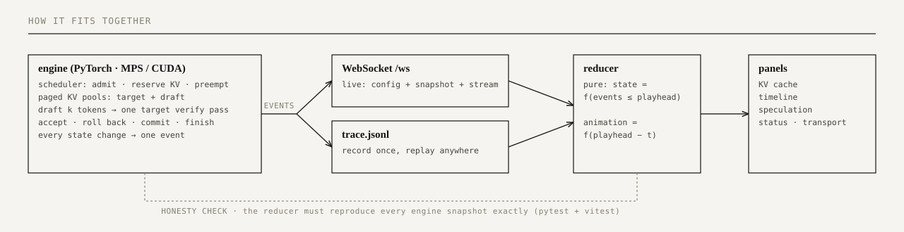
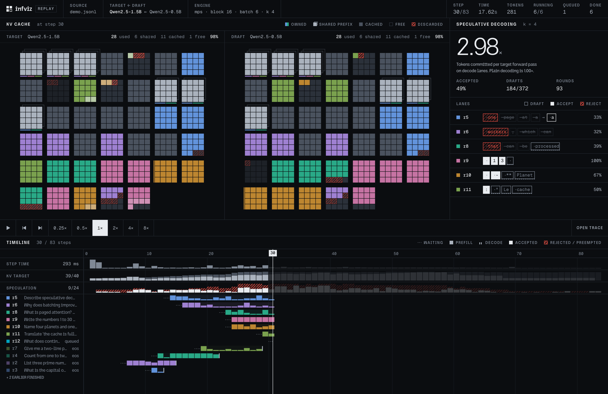

<p align="center">
  
</p>

An LLM inference server spends most of its life on bookkeeping you never see. It hands out memory in blocks, shares the prompt prefixes that requests have in common, squeezes new requests into a batch that is already running, and lets a small model guess tokens that a big model then accepts or throws away. **Production servers report all of this as averages**: a counter for accepted drafts, a percentage for cache use. You cannot watch a single block or a single rejected token.

infviz is a small, honest inference engine that **emits every one of those decisions as an event**, plus a debugger that rebuilds the engine's state from those events and lets you scrub through it step by step, live or from a recorded trace.

> **The short version.** On Qwen2.5-1.5B with a 0.5B draft model, the engine runs paged attention, prefix caching, continuous batching and speculative decoding. Its output is verified token for token against Hugging Face transformers and against plain greedy decoding. Every number on screen is rebuilt from events, and a test checks that rebuild against the engine's own snapshots. It is a tool for seeing and explaining serving, not a production profiler.

**[The idea](#1--the-idea)** · **[What you see](#2--what-you-see)** · **[A real run](#3--a-real-run)** · **[Limits](#4--where-it-does-not-help)** · **[Run it](#5--run-it)** · **[Repository map](#7--repository-map)**

---

### §1 · The idea

<p align="center">
  
</p>

- **Why a new engine.** llama.cpp's server exposes `/metrics` counters and slot status, with no per-block KV occupancy, no eviction events and no per-token accept or reject. Drawing those would mean inventing them, so infviz runs its own engine on real weights instead.
- **Paged KV cache.** Each model's KV cache is a fixed pool of 16-token blocks. Requests address it through a block table, full blocks are hashed so later requests can reuse a shared prefix, finished blocks stay cached until the least recently used one is evicted, and under memory pressure the newest request is preempted and recomputed.
- **Continuous batching.** Every engine step admits waiting requests, prefills new ones and decodes running ones in a single ragged forward pass, so requests join and leave mid-flight.
- **Speculative decoding.** The draft model proposes k = 4 tokens per lane, and the target verifies all of them in one pass. The engine keeps the accepted prefix plus one token of the target's own, and rolls back the rest of the KV cache in both pools.
- **One event stream.** Every state change is an event ([`docs/EVENTS.md`](docs/EVENTS.md)), sent over a WebSocket or written to a `.jsonl` trace. The web app's reducer is a pure function of those events. Every animation is a function of the playhead position, so scrubbing backwards plays it backwards.

---

### §2 · What you see

<p align="center">
  
</p>

| Panel | What it shows | How to read it |
|---|---|---|
| **KV cache** | Both block pools at the playhead | colour = owned by that request · stacked grey = prompt prefix shared by several requests · dark grey = cached for reuse · empty = free · red hatching = speculative KV discarded · dissolving = evicted |
| **Speculative decoding** | The headline number and each running lane's latest round | **×** = tokens committed per target forward pass (plain decoding is 1.00×) · dashed = draft guess · solid = accepted · hatched red = first rejection · outlined = the target's own token |
| **Timeline** | The whole run on one step axis, one playhead | step time · KV occupancy · accepted vs rejected drafts per step · a lane per request: dotted = waiting, block = prefill, ticks = tokens committed, × = preempted |
| **Transport** | Playback, and in live mode the engine controls | space plays, ←/→ steps, L follows live · start a load burst, slow the engine, send your own prompt |

Colour carries data and nothing else. The seven request hues are validated for colour-blind separation and contrast, **red has exactly one meaning (work that was thrown away)**, and accepted versus rejected is solid versus hatched, so it survives a grayscale screenshot.

---

### §3 · A real run

The bundled trace ([`web/public/demo.jsonl`](web/public/demo.jsonl)) is one recorded run on an M2 Pro (MPS, bf16): 16 requests arriving at random, a deliberately small 40-block pool, at most 6 requests in the batch, and k = 4.

| What happened | Count |
|---|---|
| Engine steps · tokens committed | 83 · 828 |
| Draft tokens accepted | 548 of 1,148 (47.7%) |
| Tokens committed per target verify pass | **2.91** |
| Speculation rounds by tokens accepted, 0 / 1 / 2 / 3 / 4 | 82 / 66 / 26 / 22 / 91 |
| Prefix-cache hits (target pool) | 42 blocks |
| LRU evictions · preemptions · KV rollbacks | 39 · 1 · 370 |
| Median step time | 188 ms |

The acceptance histogram has two peaks, at **0 and at all 4**. The draft model is either right about the whole continuation, as in counting, lists and formatting, or wrong from the first token. Averages hide that shape, and the speculation panel shows it one round at a time.

---

### §4 · Where it does not help

- **It debugs this engine, not yours.** infviz reads its own event protocol. It will not attach to vLLM or llama.cpp, and it will not profile a production server.
- **Fewer steps is not less time.** In a six-request test (fp32, M2 Pro), speculation cut engine steps from 66 to 37, but each step costs four sequential draft passes plus a wider verify pass, so wall-clock time went *up* (4.3 s to 7.2 s after warm-up). The headline number counts tokens per target pass, not speed-up, and the panel says so.
- **Small models, greedy only.** Qwen2.5 0.5B → 1.5B, with no temperature or sampling yet. Acceptance under sampling will differ.
- **"Lossless" is proven in fp32.** In fp32, speculative output is identical to plain greedy decoding (tests below). In bf16, the default, batch-shape-dependent rounding can occasionally flip a near-tie, as in any real serving stack.
- **Joining late loses prompts.** A browser that connects mid-run gets the cache state from a snapshot, but not the prompt text of requests that were already running.

---

### §5 · Run it

```bash
cd engine && uv sync --extra test        # torch, safetensors, tokenizers, fastapi; Python 3.11+
uv run infviz serve                      # live engine + WebSocket on :8000 (first run downloads ~4 GB of Qwen2.5)

cd web && npm install && npm run dev     # http://localhost:5173
```

Click **Start load** in the transport bar, or type a prompt and **Send**. Without an engine, the page replays the bundled trace, and `npm run build` produces a static site that does the same with no server.

```bash
uv run infviz record --out ../traces/run.jsonl -n 24 --blocks 40     # record a run headless
uv run infviz check ../traces/run.jsonl                              # honesty check on any trace
```

Drop any `.jsonl` onto the page, or open `?trace=<url>`. Deep links take `?step=45` or a fractional `?pos=30.6`, plus `&play=1` and `&speed=4`. Knobs that make things visible: `--blocks` (smaller means more eviction and preemption), `--max-batch`, `--spec-k`, `--draft none`, `--step-delay`.

**On a GPU.** [`notebooks/record_on_colab.ipynb`](notebooks/record_on_colab.ipynb) records a heavier run on Colab (optionally with a 7B target) and downloads the trace for local replay.

---

### §6 · Verify it

```bash
cd engine && uv run pytest -q            # needs the model weights
cd web && npx vitest run && TRACE=public/demo.jsonl npx vitest run
```

- **Model parity.** The paged forward pass matches Hugging Face transformers on both models (logits within 1e-4, identical argmax at every position).
- **Speculation is lossless.** In fp32, speculative output equals plain greedy output token for token, batched with staggered arrivals and again under a 12-block pool that forces eviction **and** preemption with recompute.
- **The allocator keeps its books.** Random allocate, share, roll back and release sequences hold every invariant: no double ownership, free + used + cached = total, and the hash index stays consistent.
- **The picture is the engine.** A Python reducer and the TypeScript reducer must each reproduce every engine snapshot exactly. CI runs this check and the web build on every push.

---

### §7 · Repository map

| Path | What it holds |
|---|---|
| [`engine/`](engine) | The Python package `infviz`: model (`model.py`), block allocator (`kv.py`), scheduler and speculation (`engine.py`), live server, load generator, CLI, reference reducer (`replay.py`), tests |
| [`web/`](web) | The debugger: Vite + TypeScript, Canvas 2D, no framework. `src/tokens.ts` holds every colour, size and motion value |
| [`docs/EVENTS.md`](docs/EVENTS.md) | The event protocol both halves agree on |
| [`notebooks/`](notebooks) | Recording traces on a Colab GPU |
| [`scripts/readme_figures.py`](scripts/readme_figures.py) | Regenerates the figures above from the demo trace |
| [`assets/`](assets) | README figures and screenshot |
| [`traces/`](traces) | Your recordings (git-ignored) |

---

### §8 · Credits

Built by **S Nafees**. Models: [Qwen2.5-0.5B-Instruct and Qwen2.5-1.5B-Instruct](https://huggingface.co/Qwen) (Apache 2.0). Numbers and tokens are set in Geist Mono and labels fall back to Inter Tight (both OFL). The display face, Brutal Milk No 3, is an Envato-licensed font that is **not part of this repository**. The UI loads it from `web/public/fonts/licensed/` when present and falls back cleanly when it is absent.

**License:** none chosen yet; this is a private repository.

---

<sub>**P.S.** The two figures at the top are drawn by `scripts/readme_figures.py` straight from the recorded trace, using the reducer that the tests check, so even the README is rebuilt from events.</sub>
